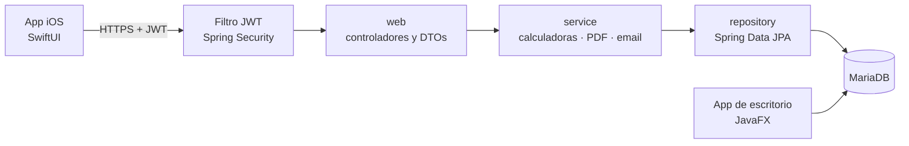

# GestionAp PRO API + iOS

**API REST segura y app iOS para que propietarios e inquilinos consulten pisos, contratos y rentabilidad desde el móvil, sobre la misma base de datos que la app de escritorio [GestionAp PRO](https://github.com/nelsongomezsa/gestionAPPRO).**

[](https://github.com/nelsongomezsa/gestionapro/actions/workflows/ci.yml)


> **English summary:** Spring Boot 3.5 REST API (Java 21) secured with Spring Security and JWT, with role-based access (admin, owner, tenant), one-time tenant invitations, PDF contracts and a property-profitability calculator; plus a native SwiftUI iOS client. The API shares its MariaDB database with the JavaFX desktop app and has 83 tests (unit and MockMvc integration) running on H2.

---

## Qué resuelve

La app de escritorio solo se usa desde un ordenador. Esta API abre los mismos datos al móvil, con seguridad por roles: cada propietario ve solo sus pisos y cada inquilino solo su contrato.

## Funcionalidades

**API REST**
- **Login con JWT** (8 horas). Las contraseñas antiguas en SHA-256 se migran a BCrypt al iniciar sesión.
- **Roles**: `ADMIN`, `PROPIETARIO` e `INQUILINO`. Un recurso ajeno responde **404**, no 403, para no revelar qué ids existen.
- **Pisos**: CRUD con ocupación, ingresos y métricas (rentabilidad bruta y neta, cash flow, cash-on-cash, PER…).
- **Invitaciones de inquilino**: códigos de un solo uso que caducan a los 7 días; se guarda solo su SHA-256.
- **Contrato en PDF** (iText 7), accesible para el admin, el propietario del piso o el inquilino del contrato.
- **Calculadora de rentabilidad** con el ITP de las 17 comunidades autónomas, Ceuta y Melilla.
- **Errores JSON homogéneos** con un `codigo` estable para el cliente.
- **Swagger UI** con autorización por token.

**App iOS (SwiftUI)**
- Login con el token guardado en el **Keychain**; un token caducado devuelve al login.
- Pestañas **Inicio · Pisos · Cobros · Incidencias · Más** para propietarios y administradores.
- **Inicio** con el resumen de la cartera: cash flow, ingresos del mes, ocupación y habitaciones libres.
- **Pisos** en tarjetas con semáforo de rentabilidad, buscador, filtro por ciudad y orden; detalle con indicadores y métricas.
- **Calculadora** con resumen que se recalcula al escribir, ITP por comunidad, desglose y gráfico con Swift Charts.
- Sistema de diseño propio (morado de la marca, cifras con dígitos alineados) en modo claro y oscuro, con importes en formato español (`2.500,00 €`).

Capturas en [`docs/capturas/`](docs/capturas/README.md) y avance frente al escritorio en [`docs/PARIDAD.md`](docs/PARIDAD.md).


## Stack

| Parte | Tecnología |
|---|---|
| API | Java 21 · Spring Boot 3.5 (Web, Data JPA, Security, Validation, Mail) · JJWT · springdoc-openapi |
| Datos | MariaDB / MySQL (compartida con el escritorio) · H2 en tests |
| Documentos | iText 7 (PDF) |
| iOS | Swift 6 · SwiftUI · Swift Charts · async/await · XcodeGen, sin dependencias externas |
| Tests | JUnit 5 · MockMvc · Spring Security Test |

## Arquitectura



## Cómo ejecutarlo (API)

Requisitos: JDK 21, Maven 3.9+ y MariaDB con la base de GestionAp PRO.

1. **Clona el repositorio**
   ```bash
   git clone https://github.com/nelsongomezsa/gestionapro.git && cd gestionapro/api
   ```
2. **Aplica la migración** `sql/V1__api_propietarios_inquilinos_invitaciones.sql` a la base del escritorio (los detalles y el orden están en [`api/README.md`](api/README.md)).
3. **Arranca con el perfil de desarrollo**
   ```bash
   export JWT_SECRET=$(openssl rand -base64 48)
   mvn spring-boot:run -Dspring-boot.run.profiles=dev
   ```

API en `http://localhost:8080` y Swagger UI en `http://localhost:8080/swagger-ui.html`.

La app iOS se abre con XcodeGen (`cd ios && xcodegen generate && open GestionApPro.xcodeproj`); los requisitos están más abajo.

## Endpoints principales

| Método | Ruta | Roles |
|---|---|---|
| POST | `/api/auth/login` | público |
| POST | `/api/auth/register-inquilino` | público (con código de invitación) |
| GET | `/api/me` | todos |
| GET · POST · PUT · DELETE | `/api/pisos` y `/api/pisos/{id}` | PROPIETARIO, ADMIN |
| POST | `/api/inquilinos/{id}/invitaciones` | PROPIETARIO, ADMIN |
| GET | `/api/contratos/{id}/pdf` | todos (con permiso sobre el contrato) |
| POST | `/api/calculadora/rentabilidad` | PROPIETARIO, ADMIN |
| GET | `/api/calculadora/itp` | PROPIETARIO, ADMIN |

La tabla completa, los códigos de error y un ejemplo con `curl` están en [`api/README.md`](api/README.md).

## Tests

```bash
cd api && mvn test
```

**83 tests** en H2, sin necesidad de MariaDB:
- Calculadoras financieras con los mismos valores esperados que el escritorio.
- Integración con MockMvc: login, JWT, aislamiento entre propietarios, invitaciones de un solo uso y caducadas, PDF por roles y errores JSON.
- Arranque: sin perfil activo, o en producción sin un `JWT_SECRET` válido, la API no arranca.

**App iOS:** 32 tests unitarios en verde en el simulador (decodificación con JSON reales de la API, `APIClient` con `URLProtocol` simulado, sesión y formatos), más un recorrido de UI que inicia sesión, comprueba los 8 pisos y guarda las capturas. Probada en el iPhone 18 Pro (iOS 27) contra la API en `dev`: login, pisos, calculadora y perfil, en modo claro y oscuro.

## Qué aprendí

- A proteger una API con Spring Security y JWT, y a separar lo que ve cada rol.
- A reutilizar una base de datos existente sin romper la app que ya la usa: la migración solo añade y la API traduce los roles antiguos.
- A comprobar que dos implementaciones calculan lo mismo, con tests que comparan la API con los valores reales del escritorio.
- A no dejar que una configuración de desarrollo llegue a producción: sin perfil explícito, la API no arranca.

## Próximos pasos

- Completar la paridad con el escritorio (ver [`docs/PARIDAD.md`](docs/PARIDAD.md)): habitaciones, inquilinos, contratos, cobros, calendario, estadísticas, notificaciones, incidencias y usuarios.
- Pantallas del inquilino en iOS.
- Automatizar la migración con Flyway.

## App iOS: requisitos

- macOS con **Xcode 16 o posterior** y un simulador de iPhone con iOS 17+.
- **XcodeGen**: `brew install xcodegen`.
- La API en marcha en `localhost:8080`.

```bash
cd ios
xcodegen generate
xcodebuild -scheme GestionApPro -destination 'platform=iOS Simulator,name=iPhone 17' build
```

En Debug la app usa `http://localhost:8080` con una excepción ATS solo para red local; en Release exige HTTPS.

## Licencia

Código propio bajo licencia [MIT](LICENSE). La API usa iText 7, que es AGPL: al servir PDFs desde la API, su código debe ser público, y lo es.

## Autor

**Nelson Gómez Sánchez** · Estudiante de DAM y del Máster en Data & Analytics · [nelsongomezsa.github.io](https://nelsongomezsa.github.io) · [LinkedIn](https://www.linkedin.com/in/nelson-gómez-sánchez)
