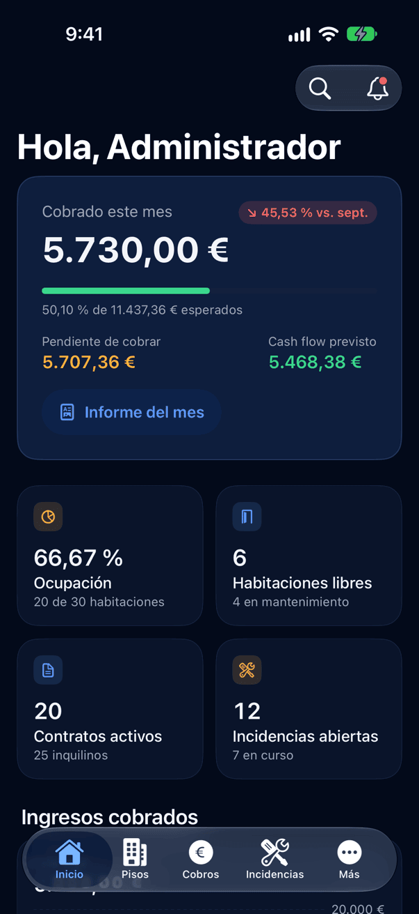
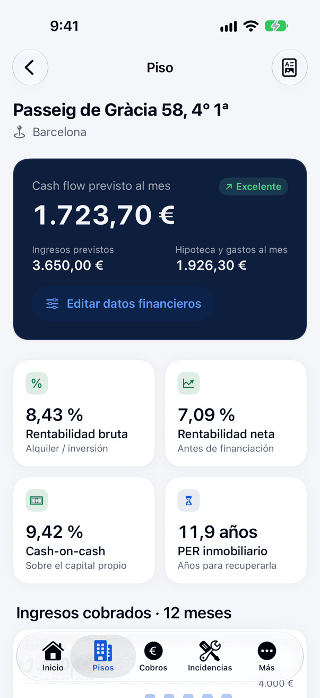
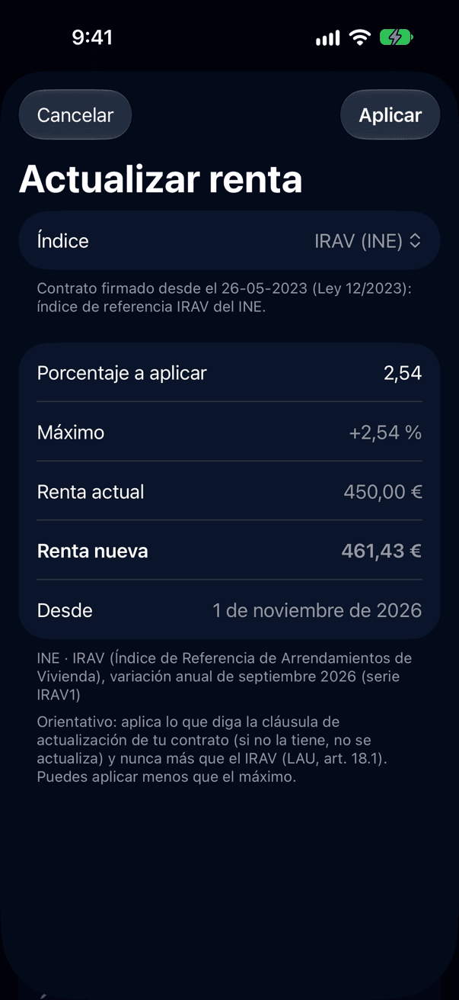
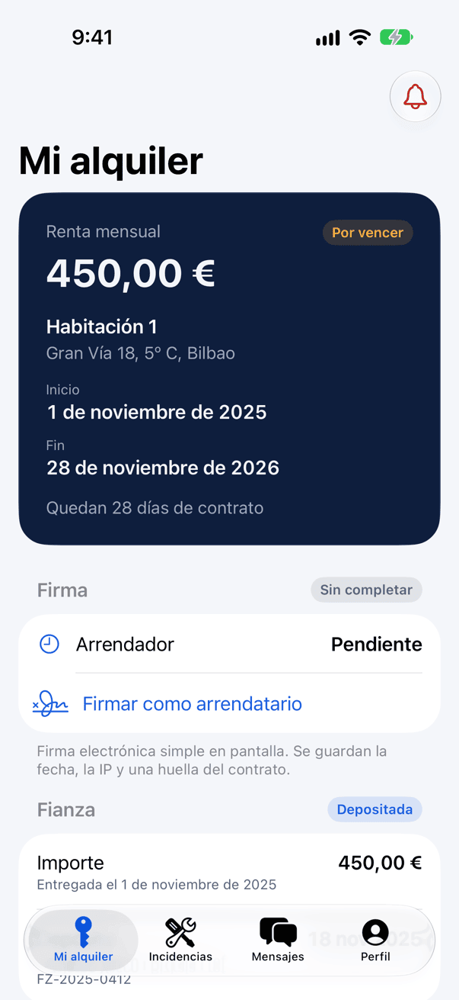
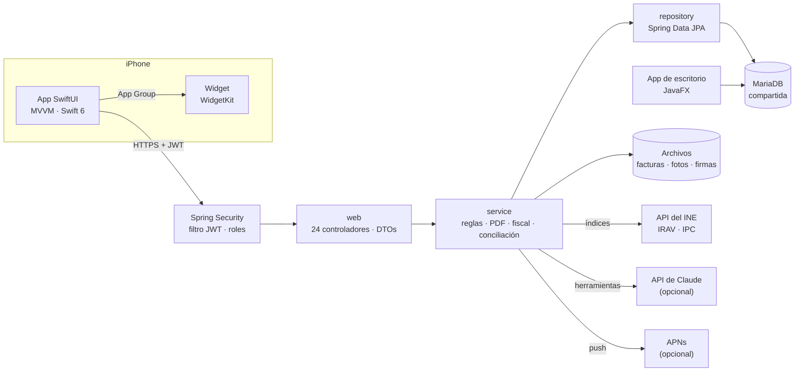

# GestionAp PRO · API + iOS

**Gestión de alquiler de habitaciones desde el iPhone: una API REST en Spring Boot y una app nativa en SwiftUI que comparten la base de datos con la app de escritorio [GestionAp PRO](https://github.com/nelsongomezsa/gestionAPPRO).**

[](https://github.com/nelsongomezsa/gestionapro/actions/workflows/ci.yml)


> **English summary:** A Spring Boot 3.5 / Java 21 REST API (JWT, role-based access for admin, owner and tenant) and a native SwiftUI iOS app (Swift 6 strict concurrency) for managing room rentals in Spain. It shares a MariaDB database with an existing JavaFX desktop app without breaking it. Features include numbered PDF receipts, deposits, annual rent updates using live official indices from Spain's statistics office (INE), real expenses with invoice photos, an indicative tax summary, bank-statement reconciliation, on-screen contract signing, owner–tenant messaging, Face ID, a home-screen widget, and an optional AI assistant built on the Claude API with server-side tools and user-confirmed actions. 199 API tests and 79 iOS tests.

<p>




</p>

[Más capturas en claro y oscuro](docs/capturas/README.md) · [Vídeo del recorrido (70 s)](docs/video/recorrido.mp4) · [Caso de estudio](docs/CASO_DE_ESTUDIO.md)

---

## Qué es

Un propietario que alquila habitaciones necesita saber, cada mes, quién ha pagado, qué contratos vencen,
qué se ha roto y cuánto gana de verdad cada piso. La app de escritorio lo resolvía, pero solo delante del
ordenador. Este proyecto lleva esos datos al móvil, y también al inquilino, con seguridad por roles: cada
propietario ve solo lo suyo y cada inquilino solo su alquiler.

## Funcionalidades

**Gestión (paridad con el escritorio)**
- Pisos con rentabilidad (bruta, neta, cash flow, cash-on-cash, PER), mapa y PDF.
- Habitaciones, inquilinos con invitación de un solo uso, contratos con PDF y recordatorios.
- Cobros del mes, calendario, estadísticas, incidencias, notificaciones, actividad y usuarios.
- Calculadora de rentabilidad con el ITP de cada comunidad autónoma.

**Lo que el escritorio no tenía**
- **Recibos PDF numerados** por propietario y año, para verlos, compartirlos o enviarlos por email.
- **Fianzas:** entrega, depósito en el organismo autonómico y devolución, con motivo si se retiene algo.
- **Actualización anual de la renta** con el **IRAV o el IPC del INE leídos en directo** de su API oficial.
  Nunca supera el IRAV (LAU, art. 18.1). El propietario la revisa y la confirma, y queda en el historial.
- **Avisos de cobro:** «cobro vencido» pasado el día 7 (LAU, art. 17.2) y recordatorio al inquilino.
- **Gastos reales** con foto de la factura. Las incidencias resueltas con coste generan su gasto y la
  rentabilidad usa los gastos reales.
- **Resumen fiscal anual** orientativo (reglas del manual de Renta de la Agencia Tributaria), en PDF y CSV.
- **Fotos de incidencias** e **inventarios** de entrada y salida con PDF para firmar.
- **Conciliación bancaria por CSV:** propone qué ingreso es de qué inquilino y el propietario confirma.
- **Firma de contratos en pantalla** y **mensajería** propietario ↔ inquilino.
- **Asistente con IA** (API de Claude) que responde sobre la cartera y prepara acciones que confirmas tú.
- **Face ID**, **widget** de Inicio, recordatorios locales y push preparadas.

**Diseño:** sistema propio en azul marino y azul eléctrico, modo claro y oscuro, Dynamic Type, VoiceOver y
contraste AA. Ningún importe ni nombre importante se corta.

## Arquitectura



- **Una base, dos aplicaciones.** La API comparte MariaDB con el escritorio. Las migraciones (`api/sql/V1…V8`)
  solo **añaden** tablas o columnas que admiten nulos, y la API valida el esquema al arrancar
  (`ddl-auto=validate`).
- **API por capas:** `web` (controladores y DTOs), `service` (reglas y control de acceso) y `repository`
  (JPA). Un recurso ajeno responde **404**, no 403, para no revelar qué ids existen.
- **App iOS sin dependencias externas:** MVVM con `@Observable`, `async/await` y concurrencia estricta de
  Swift 6, un cliente HTTP con errores tipados y un sistema de diseño con tokens.

## Stack

| Parte | Tecnología |
|---|---|
| API | Java 21 · Spring Boot 3.5 (Web, Data JPA, Security, Validation, Mail, Actuator) · JJWT · springdoc-openapi · iText 7 · SDK oficial de Anthropic para Java |
| Datos | MariaDB / MySQL (compartida con el escritorio) · H2 en los tests |
| iOS | Swift 6 · SwiftUI · Swift Charts · WidgetKit · LocalAuthentication · UserNotifications · PhotosUI · XcodeGen |
| Calidad | JUnit 5 · MockMvc · Spring Security Test · Swift Testing · XCUITest · GitHub Actions |
| Despliegue | Docker (multietapa, JRE 21, usuario sin privilegios), perfil `prod` por variables de entorno |

## Cómo ejecutarlo

Requisitos: JDK 21, Maven 3.9+, MariaDB (por ejemplo, la de XAMPP), Xcode 16+ y XcodeGen (`brew install xcodegen`).

**API**
```bash
git clone https://github.com/nelsongomezsa/gestionapro.git && cd gestionapro/api
mysql -u root -e "CREATE DATABASE gestion_alquileres_pro"
mysql -u root gestion_alquileres_pro < sql/esquema_completo.sql   # base nueva; en la del escritorio, las V1…V8 en orden
export JWT_SECRET=$(openssl rand -base64 48)
mvn spring-boot:run -Dspring-boot.run.profiles=dev
```
API en `http://localhost:8080`, Swagger en `/swagger-ui.html` y salud en `/actuator/health`.

**iOS**
```bash
cd ios && xcodegen generate && open GestionApPro.xcodeproj   # simulador iPhone 18 Pro
```
En Debug la app usa `http://localhost:8080` con una excepción ATS solo para red local; en Release exige HTTPS.

**Opcionales:** asistente con IA ([`docs/ASISTENTE.md`](docs/ASISTENTE.md)), push ([`docs/NOTIFICACIONES.md`](docs/NOTIFICACIONES.md)),
nube ([`docs/DESPLIEGUE.md`](docs/DESPLIEGUE.md)). Capturas y vídeo: `ios/scripts/capturas.sh` y `ios/scripts/video.sh`.

## Decisiones técnicas

Están razonadas en [`docs/DECISIONES.md`](docs/DECISIONES.md). Las principales:

- **No romper el escritorio.** Solo tablas nuevas; los datos que comparten (renta, pagos) se escriben con el
  mismo significado. Por eso Supabase/PostgreSQL no compensa todavía ([`docs/DESPLIEGUE.md`](docs/DESPLIEGUE.md)).
- **Datos oficiales, no cifras inventadas.** El IRAV y el IPC salen en directo de la API del INE. El
  certificado del INE lo emite la FNMT, cuya raíz no viene en Java: se añadió la raíz, comprobando su huella.
  Lo legal (LAU, Ley 12/2023, RDL 29/2026, manual de Renta) se cita y, si hay dudas, es configurable.
- **Lo que la IA no hace sola.** El asistente consulta con las herramientas de la API y los permisos del
  usuario, nunca con SQL generado. Pagos, incidencias y recordatorios solo se proponen y el usuario los
  confirma. La clave vive solo en el servidor; sin ella, el asistente aparece desactivado. Usa Claude
  Haiku 5.5 por defecto (≈ 0,2 céntimos por consulta).
- **Concurrencia:** la numeración de recibos y la generación de avisos bloquean la fila que toca, y las
  claves únicas evitan duplicados aunque haya dos peticiones a la vez.

## Seguridad

- JWT de 8 horas firmado con un secreto que la API exige al arrancar en producción; BCrypt para las
  contraseñas, con migración automática de los hashes SHA-256 antiguos.
- Control de acceso en cada servicio: propietario, inquilino y admin solo ven lo suyo, con tests de
  aislamiento en cada módulo.
- Archivos subidos: se comprueba el formato real (cabecera y decodificación), máximo 10 MB, nombres
  aleatorios y rutas que no pueden salir de su carpeta. El CSV exportado neutraliza fórmulas.
- Secretos solo por variables de entorno (`JWT_SECRET`, `DB_*`, `ANTHROPIC_API_KEY`, `APNS_*`); los datos de
  demostración son ficticios (DNI `00000001R`…, emails `@example.com`).
- iOS: token en el Keychain, Face ID opcional y HTTPS obligatorio en Release.

## Tests

```bash
cd api && mvn test            # 199 tests en H2, sin MariaDB ni red
cd ios && xcodebuild test -scheme GestionApPro -destination 'platform=iOS Simulator,name=iPhone 18 Pro' \
  -only-testing:GestionApProTests   # 79 tests
```

- **API:** integración con MockMvc de cada módulo (roles y aislamiento entre propietarios), reglas de
  negocio con fechas fijas (avisos, renta, fiscal), la calculadora con los mismos valores que el escritorio,
  y el asistente con un **modelo simulado** que nunca llama a la API real.
- **iOS:** decodificación con JSON reales de la API, el cliente HTTP con un servidor simulado, formatos y
  lógica de vistas, y recorridos de interfaz que generan las capturas y el vídeo.
- **CI:** GitHub Actions compila y pasa los tests de la API en cada push.

## Documentación

| Documento | Contenido |
|---|---|
| [`docs/CASO_DE_ESTUDIO.md`](docs/CASO_DE_ESTUDIO.md) | El proyecto contado para una entrevista: problema, decisiones, resultados |
| [`docs/COMPARATIVA.md`](docs/COMPARATIVA.md) | Nota sincera frente a Rentila y Rentger: qué tiene y qué le falta para competir |
| [`docs/PARIDAD.md`](docs/PARIDAD.md) | Cada función del escritorio y su equivalente, más lo nuevo |
| [`docs/DECISIONES.md`](docs/DECISIONES.md) | Decisiones técnicas con su porqué |
| [`docs/DESPLIEGUE.md`](docs/DESPLIEGUE.md) | Docker, variables y comparación de tres opciones de nube |
| [`docs/ASISTENTE.md`](docs/ASISTENTE.md) | El asistente con IA: cómo funciona, cómo activarlo y su coste |
| [`docs/CONCILIACION.md`](docs/CONCILIACION.md) · [`docs/FIRMA.md`](docs/FIRMA.md) · [`docs/NOTIFICACIONES.md`](docs/NOTIFICACIONES.md) | Conciliación bancaria, firma y notificaciones |
| [`api/README.md`](api/README.md) | Endpoints, errores y ejemplos con `curl` |

## Estado

Funciona en local contra MariaDB y en el simulador. Pendiente de decidir:
- **La nube:** está preparada y comparada, pero sin ninguna cuenta creada.
- **La clave de la API de Claude:** con ella, el asistente pasa de desactivado a activo.
- **La cuenta de Apple Developer:** hace falta para firmar la app y activar las notificaciones push reales.

## Licencia

Código propio bajo licencia [MIT](LICENSE). La API usa iText 7, que es AGPL: al servir PDFs desde la API, su código debe ser público, y lo es.

## Autor

**Nelson Gómez Sánchez** · Estudiante de DAM y del Máster en Data & Analytics · [nelsongomezsa.github.io](https://nelsongomezsa.github.io) · [LinkedIn](https://www.linkedin.com/in/nelson-gómez-sánchez)
