# Capturas destacadas

Escaparate de la versión 2.2 en el simulador iPhone 18 Pro (iOS 27), en modo claro y oscuro, con datos de
demostración inventados. Se generan con `ios/scripts/capturas.sh Escaparate <url-api-de-pruebas>` (recorrido
`testEscaparate`); las capturas de trabajo de cada fase van a `docs/capturas-local/` y no se versionan.

Vídeo del recorrido: [`docs/video/recorrido.mp4`](../video/recorrido.mp4).

| | |
|---|---|
| **Inicio: cobrado del mes, resúmenes, barra con «+» y lengüeta del asistente**   | **Cartera de pisos**   |
| **Detalle de piso y rentabilidad**   | **Cobros del mes agrupados por piso** 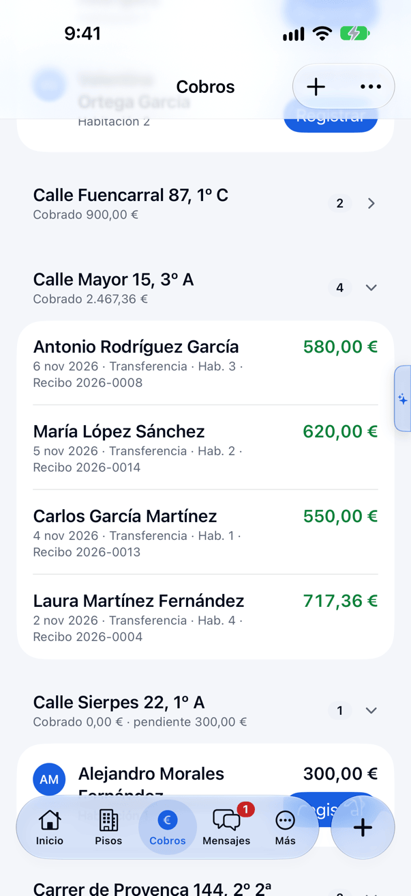 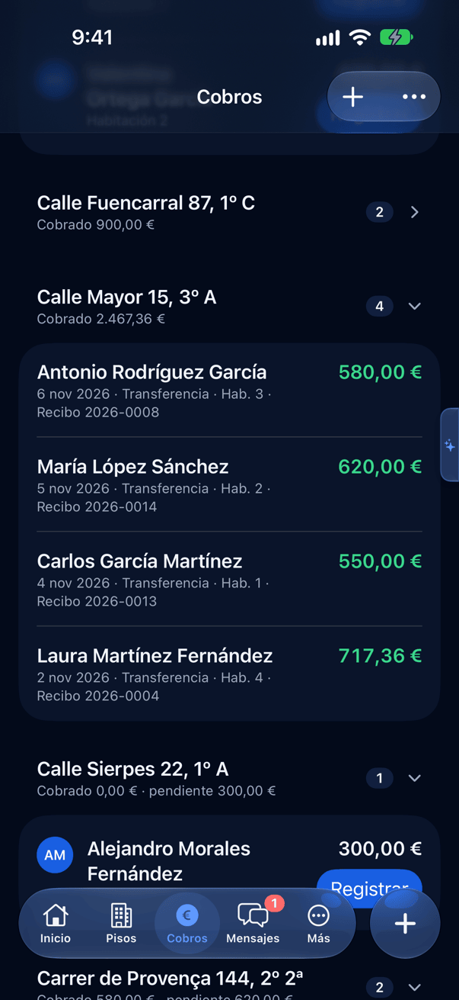 |
| **Estadísticas** 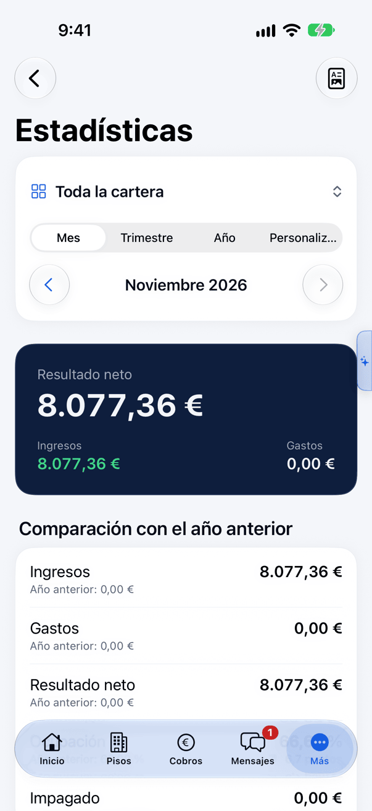 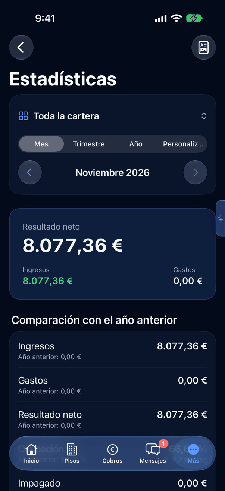 | **Calculadora: análisis de inversión comparados** 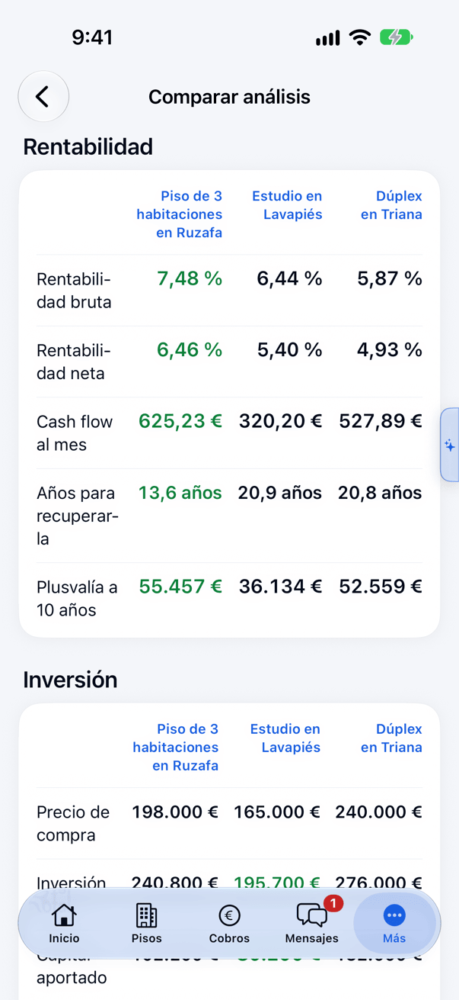 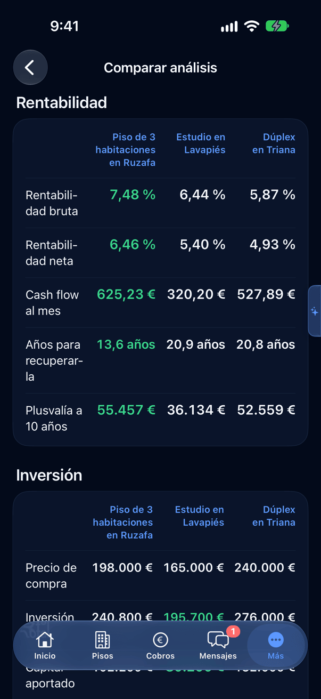 |
| **Mensajes con el inquilino** 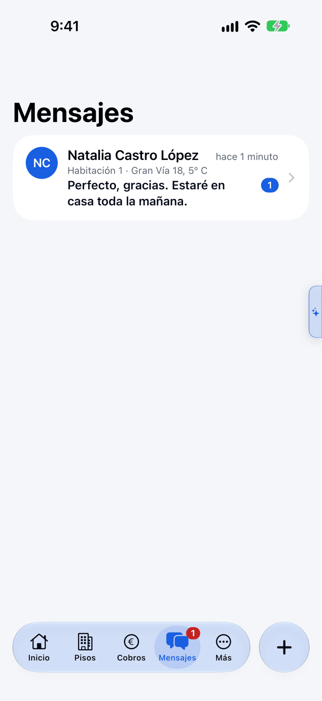 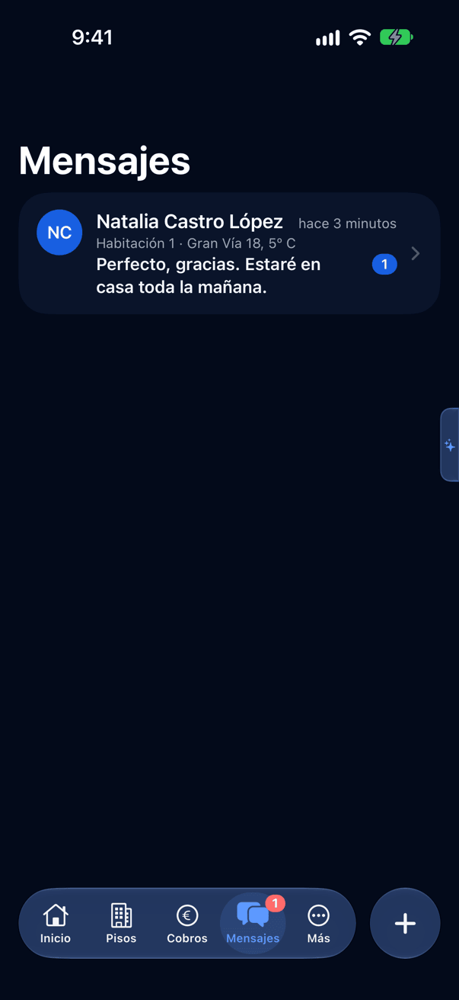 | **Ajustes** 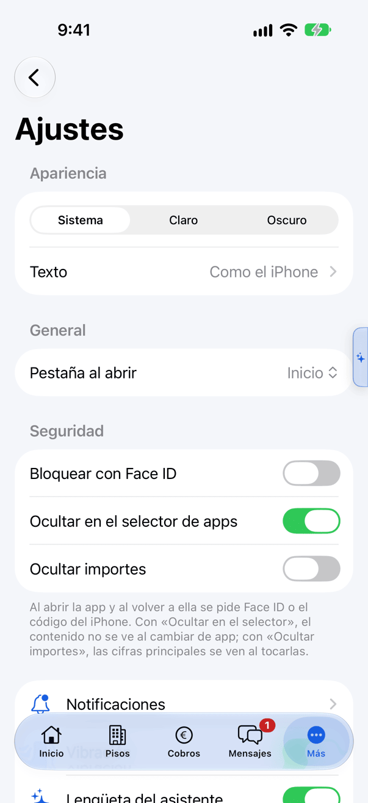  |
| **Vista del inquilino: Mi alquiler** 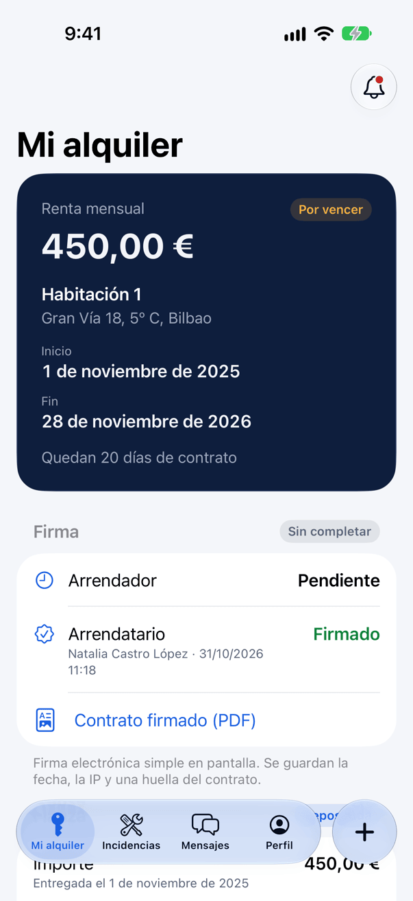 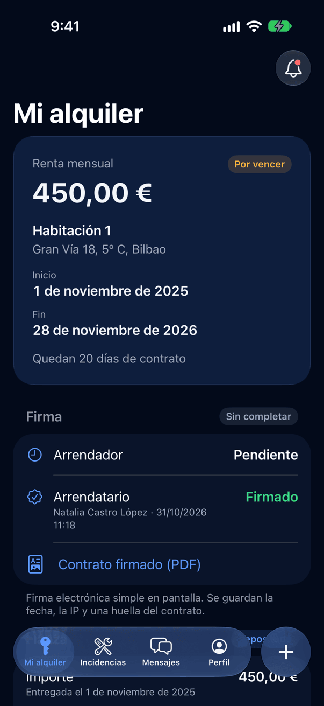 | |
